# SQL Leaderboard · Hướng dẫn cho team nội dung

Phiên bản 2 · 08/11/2026 · Thay cho bản "Câu hỏi và cách scale độ khó" (07/11).

Tài liệu này nói **soạn câu gì và làm sao cho khó dần**. Cú pháp LaTeX chi tiết nằm trong [goi-cau-hoi-mau/HUONG_DAN.md](goi-cau-hoi-mau/HUONG_DAN.md).

**Thay đổi so với bản cũ**

- Bỏ hình thức **Diễn giải insight** (chọn kết luận khi không viết SQL không hợp với leaderboard SQL). Phần đọc kết quả, chọn kết luận chuyển vào **bước cuối của Case study**.
- Thêm hình thức **Tối ưu truy vấn**.
- Case study có cả cấp Cơ bản. Bộ mẫu giờ là **16 câu** (4 hình thức × 4 cấp), thay cho 15 câu cũ.
- Soạn câu bằng **LaTeX trên Overleaf** theo gói mẫu, rồi tải zip lên hệ thống. Không soạn trên tài liệu rời nữa.
- SQL viết theo **MySQL 8.0** (hệ thống chấm bằng MySQL). Dùng `DATE_FORMAT`, `YEAR`, `MONTH`, `COUNT(CASE WHEN … THEN 1 END)`; không dùng `strftime`, `FILTER (WHERE …)`. Cột tên `date` viết là `` `date` ``.

## 1. Mục tiêu và bộ dữ liệu

Học viên DA luyện SQL trên dữ liệu thật của một công ty. Mục tiêu là vừa thạo cú pháp, vừa hiểu nghiệp vụ, và leo bảng xếp hạng theo điểm. Mỗi câu gắn một **cấp độ** (Cơ bản 10 · Dễ 20 · Trung bình 30 · Khó 50 điểm) và một **domain**.

Bộ dữ liệu đầu tiên là **Datathon 2026 Round 1**: một công ty thương mại điện tử thời trang tại Việt Nam, 14 bảng, khoảng 2,2 triệu dòng, từ 04/07/2012 đến 31/12/2022. Vì chỉ có một công ty, "domain" ở đây là **6 mảng nghiệp vụ** bên trong công ty đó.

| Domain (`domain=`) | Bảng chính | Câu hỏi điển hình |
| --- | --- | --- |
| Bán hàng (`sales`) | orders, order_items, products, sales | Doanh thu, AOV, sản phẩm bán chạy |
| Marketing (`marketing`) | promotions, web_traffic, orders.order_source, customers.acquisition_channel | Kênh nào hiệu quả, khuyến mãi có đáng không |
| Khách hàng (`customer`) | customers, geography, orders | Mua lại, cohort, phân khúc theo vùng, độ tuổi |
| Vận hành (`operations`) | shipments, inventory | Thời gian giao, tồn kho, hết hàng |
| Tài chính (`finance`) | payments, products.cogs, sales | Biên lợi nhuận, trả góp, đối soát |
| Hậu mãi (`after_sales`) | returns, reviews | Tỷ lệ trả, lý do trả, điểm đánh giá |

Quy mô: orders 646.945 · order_items 714.669 · customers 121.930 · products 2.412 · shipments 566.067 · reviews 113.551 · returns 39.939. **Dữ liệu là private**, không đưa file gốc ra ngoài.

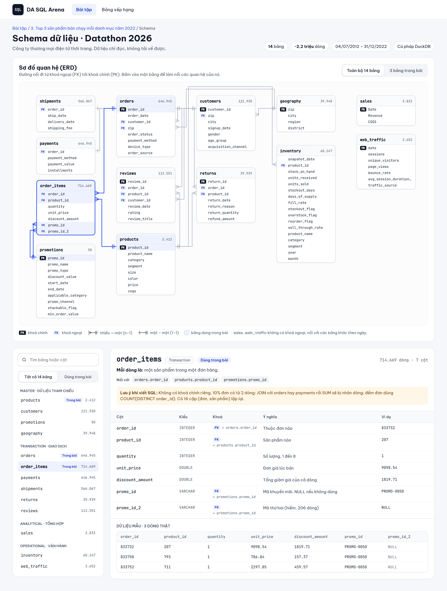

## 2. Bốn hình thức câu hỏi

| Hình thức (`hinhthuc=`) | Học viên làm gì | Chấm |
| --- | --- | --- |
| Viết truy vấn (`write`) | Đọc yêu cầu, tự viết SQL | So bảng kết quả trên mọi biến thể dữ liệu (`public` và `hidden-*`) |
| Sửa lỗi (`debug`) | Nhận truy vấn chạy được nhưng **ra sai số**, sửa cho đúng | Như Viết truy vấn |
| Tối ưu truy vấn (`optimize`) | Nhận truy vấn **đúng nhưng chậm**, viết lại cho cùng kết quả và thoả ràng buộc | Kết quả + số lần quét bảng + số dòng trung gian (đo bằng `EXPLAIN ANALYZE`, không đo thời gian) |
| Case study (`case`) | Đi qua nhiều bước viết SQL nối nhau, bước cuối chọn kết luận | Cộng điểm từng bước; bước sau mở khi bước trước đúng |

Đã loại: **Đoán kết quả** (lên cấp cao chỉ thành tính nhẩm), **Điền chỗ trống** (khung cho sẵn làm lộ phần khó nhất), **Diễn giải insight** (xem trên).

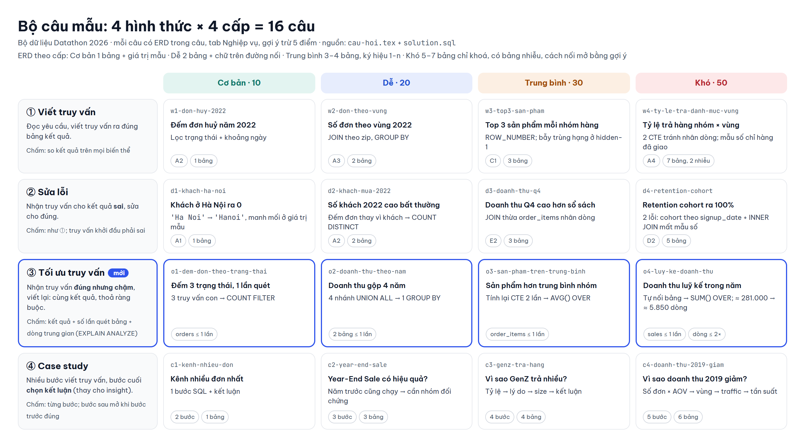

## 3. Khung chung của một câu

Mọi câu có cùng 8 phần. Các hình thức chỉ khác nhau ở vùng trả lời ⑦ và cách chấm. Trong ngoặc là lệnh tương ứng trong `cau-hoi.tex`.

| Phần | Nội dung | Lệnh |
| --- | --- | --- |
| ① Nhãn | Hình thức, cấp, điểm, domain, dạng | khoá của `cauhoi` |
| ② Tiêu đề | Câu hỏi kinh doanh, ngắn | `\tieude` |
| ③ Bối cảnh | Ai hỏi (tên, vai trò), vì sao cần. Không nhắc tên kỹ thuật SQL | `\boicanh` |
| ④ Yêu cầu | Cột đầu ra, sắp xếp, quy tắc khi hoà, quy tắc nghiệp vụ. Câu tối ưu thêm khung Ràng buộc | `yeucau`, `rangbuoc` |
| ⑤ Dữ liệu | ERD riêng của câu, to dần theo cấp (mục 5) | `erd` |
| ⑥ Tab Nghiệp vụ | Câu giúp quyết định gì, quy trình, khái niệm, lưu ý | `nghiepvu` |
| ⑦ Vùng trả lời | Editor trống / có code sai / có code chậm / từng bước | (từ `solution.sql`) |
| ⑧ Hành động | Gợi ý (mỗi nấc trừ 5 điểm, tối đa trừ 50%), Chạy thử, Nộp | `\goiy` |

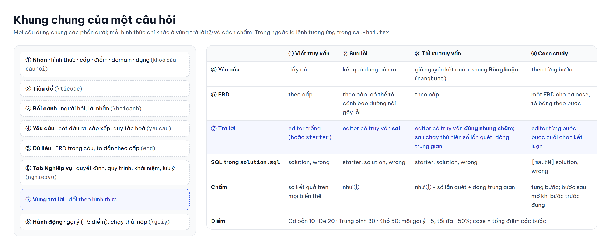

Giao diện từng hình thức (bản sơ bộ):

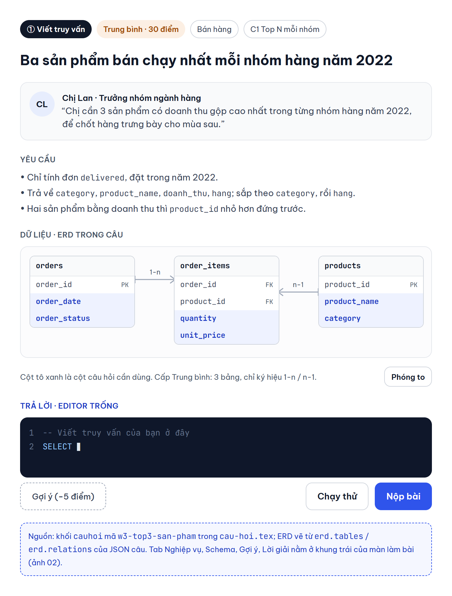

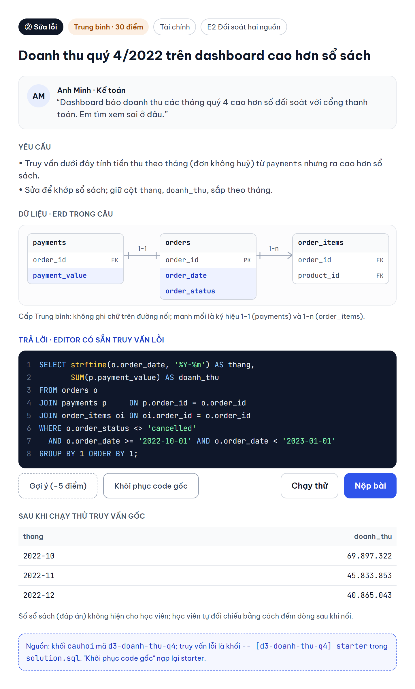

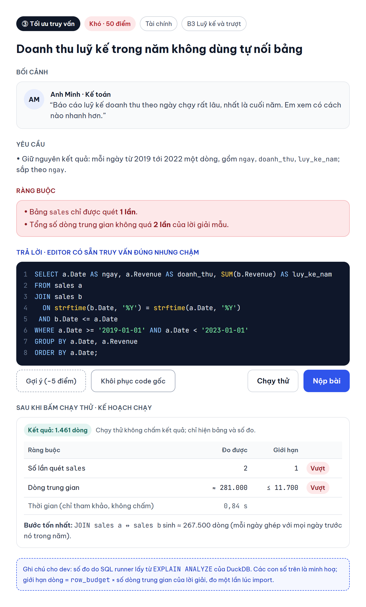

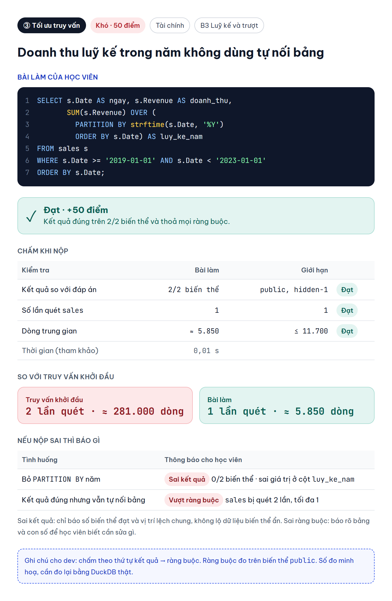

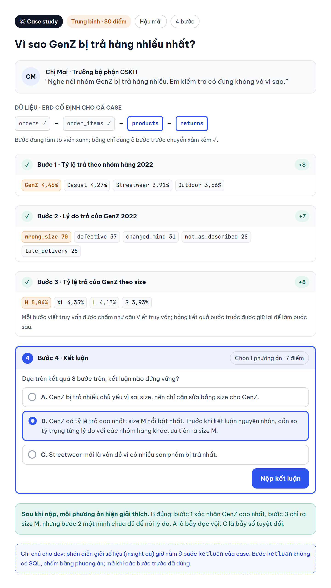

Video ~70 giây: [video/demo-luong-lam-bai.mp4](video/demo-luong-lam-bai.mp4). Video đi qua một câu Viết truy vấn, một câu Tối ưu truy vấn và bước kết luận của Case study.

## 4. Tab Nghiệp vụ

Mỗi câu có hai tab: **Đề bài** và **Nghiệp vụ**. Tab Nghiệp vụ gồm:

1. **Mảng nghiệp vụ**: mảng đó làm gì trong công ty (lấy từ `\khaibaodomain`).
2. **Câu hỏi này giúp quyết định gì**: người hỏi sẽ dùng kết quả để làm gì.
3. **Quy trình liên quan** (khi cần, tối đa một): ví dụ vòng đời đơn `created → paid → shipped → delivered`, nhánh `cancelled, returned`.
4. **Khái niệm**: tên, định nghĩa, công thức, và "trong bộ dữ liệu" (cột nào, quy tắc nào). Khái niệm khai báo **một lần** ở đầu `cau-hoi.tex` bằng `\khaibaokhainiem` rồi dùng lại ở nhiều câu. Học viên học domain qua chính các thẻ này.
5. **Lưu ý**: các hiểu lầm hay gặp.

**Nguyên tắc: tab Nghiệp vụ dạy định nghĩa và quy tắc, không đưa kết quả của câu.** Ví dụ câu "Nhóm hàng nào trả nhiều nhất?" chỉ định nghĩa tỷ lệ trả và cách lấy tử số, mẫu số. Tab không được ghi sẵn "GenZ 4,46%". Máy cảnh báo nếu tab chứa con số trùng với kết quả lời giải.

Gói mẫu hiện có 14 khái niệm, như `vong-doi-don`, `doanh-thu-thuan`, `aov`, `ty-le-tra-hang`, `fan-out`, `cohort`, `khach-moi`, `lan-quet-bang`, `dong-trung-gian`. Trước khi tạo khái niệm mới, kiểm tra xem đã có chưa.

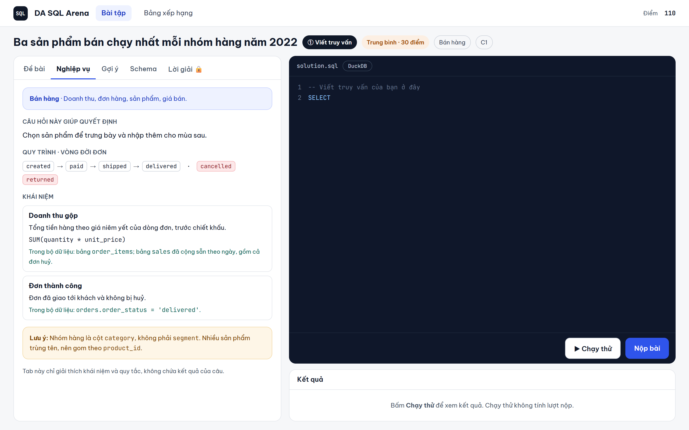

## 5. ERD nằm ngay trong câu

Mỗi câu tự vẽ ERD của mình ở phần ⑤, và chỉ vẽ đúng các bảng của câu. Người soạn chọn bảng nào hiện, cột nào tô (`cot*`), giá trị mẫu (`cot=giatri`), chữ trên đường nối, bảng nhiễu. Càng lên cấp, ERD càng lớn nhưng càng ít chỉ dẫn.

| Cấp | Số bảng | Chỉ dẫn |
| --- | --- | --- |
| Cơ bản | 1 | Cột cần dùng có **giá trị mẫu**, ví dụ `order_status*='cancelled'` |
| Dễ | 2 | Chữ ngay trên đường nối (`tren=...`), khoá thẳng hàng |
| Trung bình | 3–4 | Chỉ ký hiệu quan hệ `1-n`, không ghi tên cột nối |
| Khó | 5–7 | Chỉ khoá; thêm 1–2 bảng nhiễu; cách nối mở bằng gợi ý trả phí (`\erdkhoa`) |

Theo hình thức:

- **Sửa lỗi:** ERD vẽ các bảng trong truy vấn sai. Ở cấp Cơ bản và Dễ, ERD làm nổi chi tiết dẫn tới lỗi (giá trị mẫu, đường nối `canhbao` tô đỏ). Ở cấp Khó, ERD để trung tính.
- **Tối ưu:** ERD theo cấp như Viết truy vấn.
- **Case study:** một ERD cho cả case, vị trí bảng giữ nguyên qua các bước. Bảng của bước đang làm viền xanh (`bang=` trong `buoc`), bảng của bước trước xám kèm ✓.

## 6. Cách scale độ khó

Lên cấp nghĩa là bài phải khó hơn thật, không chỉ dài hơn. Tăng cùng lúc 5 trục: **số bảng**, **số bước xử lý**, **mức mơ hồ của đề**, **số bẫy dữ liệu**, **độ sâu nghiệp vụ**.

| Hình thức | Cơ bản · 10 | Dễ · 20 | Trung bình · 30 | Khó · 50 |
| --- | --- | --- | --- | --- |
| Viết truy vấn | 1 bảng, lọc + đếm, đề ghi rõ cột | `JOIN` 2 bảng, `GROUP BY` | CTE, hàm cửa sổ, có bẫy (trùng tên, hoà hạng) | 5–7 bảng, nhiều tầng CTE, `LEFT JOIN`, đề chỉ nói bằng ngôn ngữ kinh doanh |
| Sửa lỗi | Lỗi 1 chỗ dễ thấy (sai giá trị lọc) | `COUNT(*)` thay vì `COUNT(DISTINCT)` | JOIN thừa làm nhân dòng | 2–3 lỗi chồng nhau hoặc sai định nghĩa metric |
| Tối ưu truy vấn | 3 truy vấn con quét lại một bảng → đếm có điều kiện (`COUNT(CASE WHEN …)`) | Nhiều nhánh `UNION ALL` → một `GROUP BY` | Tính một CTE hai lần → `AVG() OVER (PARTITION BY)` | Tự nối bảng với `<=` để cộng dồn → `SUM() OVER (... ORDER BY)`, có ngân sách dòng |
| Case study | 2 bước (1 SQL + kết luận) | 3 bước | 4 bước, đề dẫn dắt | 5 bước, nhiều nguồn |

Câu Tối ưu cần ít nhất một ràng buộc. `quettoida={orders=1}` giới hạn số lần quét mỗi bảng. `ngansach=2` nghĩa là tổng số dòng trung gian không quá 2 lần lời giải mẫu. Phải viết lại ràng buộc bằng lời trong khung `rangbuoc` để học viên đọc được.

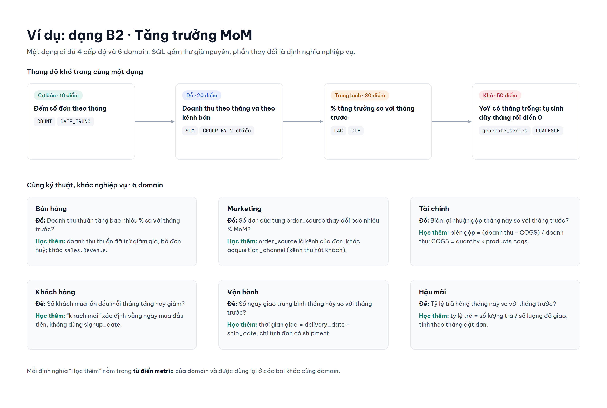

## 7. 18 dạng bài toán × 6 domain

Câu Viết truy vấn, Sửa lỗi và Tối ưu truy vấn bắt buộc gắn một `dang` (từ A1 đến E3). Có 18 dạng, chia thành 5 nhóm. Ảnh bản đồ bên dưới còn ghi "16 dạng" trên tiêu đề, nhưng nội dung vẫn đúng 18 ô. Datathon phủ 17/18 dạng; riêng E3 (cấu trúc cây) chưa có dữ liệu phân cấp.

| Dạng | Bán hàng | Marketing | Khách hàng | Vận hành | Tài chính | Hậu mãi | Đề mẫu trên Datathon |
| --- | --- | --- | --- | --- | --- | --- | --- |
| A1 Tra cứu và lọc | ✓ | ✓ | ✓ | ✓ | ✓ | ✓ | Khách 55+ ở Hanoi đăng ký qua email_campaign |
| A2 Tính KPI | ✓ | ✓ | ✓ | ✓ | ✓ | ✓ | AOV năm 2022; tỷ lệ trả hàng |
| A3 Phân rã theo chiều | ✓ | ✓ | ✓ | ✓ | ✓ | ✓ | Doanh thu theo vùng × danh mục |
| A4 Bảng chéo | ✓ | ✓ |  |  | ✓ | ✓ | Số đơn theo device_type × payment_method |
| B1 Xu hướng | ✓ | ✓ | ✓ | ✓ | ✓ | ✓ | Sessions web theo tháng |
| B2 Tăng trưởng MoM / YoY | ✓ | ✓ | ✓ | ✓ | ✓ | ✓ | Tỷ lệ trả hàng YoY theo danh mục |
| B3 Luỹ kế và trượt | ✓ | ✓ |  | ✓ | ✓ |  | Doanh thu trung bình trượt 7 ngày |
| B4 Trạng thái tại thời điểm |  | ✓ | ✓ | ✓ |  |  | Tồn kho cuối tháng 12/2022 theo danh mục |
| C1 Top N mỗi nhóm | ✓ | ✓ | ✓ | ✓ | ✓ | ✓ | Sản phẩm bị trả nhiều nhất mỗi danh mục |
| C2 Tỷ trọng / Pareto | ✓ |  | ✓ |  | ✓ |  | Bao nhiêu % khách tạo ra 80% doanh thu |
| C3 So với chuẩn | ✓ | ✓ |  | ✓ |  | ✓ | Sản phẩm rating thấp hơn trung bình danh mục |
| C4 Phân khúc | ✓ | ✓ | ✓ |  | ✓ |  | Phân khúc khách theo RFM |
| D1 Phễu | ✓ | ✓ |  | ✓ |  |  | created → paid → shipped → delivered |
| D2 Cohort và retention |  | ✓ | ✓ |  |  |  | Retention theo tháng mua đầu tiên |
| D3 Phiên và chuỗi liên tiếp | ✓ |  | ✓ | ✓ |  |  | Chuỗi tháng liên tiếp sản phẩm hết hàng |
| E1 Bất thường, chất lượng | ✓ |  | ✓ | ✓ |  | ✓ | `days_of_supply` bất thường; đơn returned không có bản ghi trả |
| E2 Đối soát hai nguồn | ✓ |  |  | ✓ | ✓ | ✓ | `sales.Revenue` so với tổng từ `order_items` |
| E3 Cấu trúc cây |  |  |  |  |  |  | Chưa có dữ liệu phân cấp |

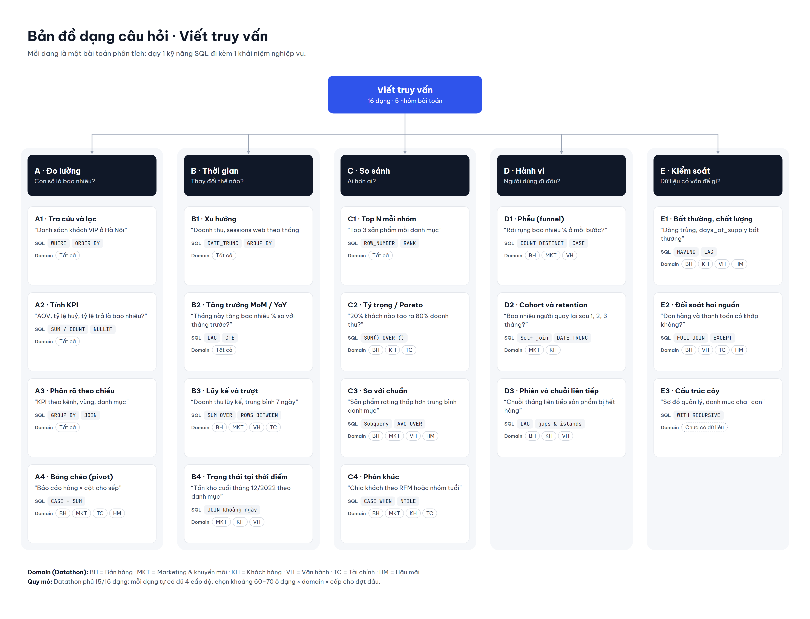

## 8. Bộ 16 câu mẫu

Bộ mẫu nằm trong [goi-cau-hoi-mau/](goi-cau-hoi-mau/). Mọi câu nằm trong `cau-hoi.tex`, mọi SQL nằm trong `solution.sql`. Khi soạn câu mới, chép câu cùng hình thức và cùng cấp ở đây ra rồi sửa.

| Mã | Hình thức · Cấp | Domain · Dạng | Tiêu đề | Bẫy chính |
| --- | --- | --- | --- | --- |
| `w1-don-huy-2022` | Viết · Cơ bản | Bán hàng · A2 | Có bao nhiêu đơn bị huỷ năm 2022? | Quên lọc năm |
| `w2-don-theo-vung` | Viết · Dễ | Khách hàng · A3 | Số đơn theo vùng năm 2022 | Quên lọc năm |
| `w3-top3-san-pham` | Viết · Trung bình | Bán hàng · C1 | Ba sản phẩm bán chạy nhất mỗi nhóm hàng 2022 | Trùng hạng (ở `hidden-1`) |
| `w4-ty-le-tra-danh-muc-vung` | Viết · Khó | Hậu mãi · A4 | Tỷ lệ trả theo nhóm hàng và vùng 2022 | Nhân dòng, sai mẫu số |
| `d1-khach-ha-noi` | Sửa lỗi · Cơ bản | Khách hàng · A1 | Số khách ở Hà Nội ra 0 | `'Ha Noi'` thay vì `'Hanoi'` |
| `d2-khach-mua-2022` | Sửa lỗi · Dễ | Khách hàng · A2 | Số khách mua 2022 cao bất thường | Đếm đơn thay vì đếm khách |
| `d3-doanh-thu-q4` | Sửa lỗi · Trung bình | Tài chính · E2 | Doanh thu Q4/2022 cao hơn sổ sách | JOIN thừa `order_items` nhân dòng |
| `d4-retention-cohort` | Sửa lỗi · Khó | Khách hàng · D2 | Cohort nào cũng giữ chân 100% | Cohort theo `signup_date` + INNER JOIN mất mẫu số |
| `o1-dem-don-theo-trang-thai` | Tối ưu · Cơ bản | Bán hàng · A2 | Đếm đơn theo trạng thái với 1 lần quét | 3 truy vấn con quét lại `orders` |
| `o2-doanh-thu-theo-nam` | Tối ưu · Dễ | Bán hàng · B1 | Doanh thu gộp 4 năm bằng một truy vấn | `UNION ALL` mỗi năm một nhánh |
| `o3-san-pham-tren-trung-binh` | Tối ưu · Trung bình | Bán hàng · C3 | Sản phẩm bán hơn trung bình nhóm | Tính lại CTE hai lần |
| `o4-luy-ke-doanh-thu` | Tối ưu · Khó | Tài chính · B3 | Doanh thu luỹ kế trong năm | Tự nối bảng (≈ 281.000 → 5.850 dòng) |
| `c1-kenh-nhieu-don` | Case · Cơ bản | Marketing | Kênh nào mang về nhiều đơn nhất 2022? | 1 bước SQL + kết luận |
| `c2-year-end-sale` | Case · Dễ | Marketing | Year-End Sale 2022 có hiệu quả không? | Năm trước cũng chạy, cần nhóm đối chứng |
| `c3-genz-tra-hang` | Case · Trung bình | Hậu mãi | Vì sao GenZ bị trả hàng nhiều nhất? | Tỷ lệ → lý do → size → kết luận |
| `c4-doanh-thu-2019-giam` | Case · Khó | Bán hàng | Vì sao doanh thu 2019 giảm mạnh? | Số đơn × AOV → vùng → traffic → khách cũ |

**Ví dụ: một câu Tối ưu cấp Cơ bản (`o1`)**

Bối cảnh: *Anh Tuấn, Data engineer: "Dashboard gọi truy vấn này mỗi phút. Nó quét bảng đơn 3 lần, em gộp lại giúp anh."* Ràng buộc: `orders` chỉ được quét 1 lần.

```sql
-- [o1-dem-don-theo-trang-thai] starter   (đúng kết quả, nhưng quét orders 3 lần)
SELECT
  (SELECT COUNT(*) FROM orders WHERE order_status = 'cancelled'
     AND order_date >= '2022-01-01' AND order_date < '2023-01-01') AS so_huy,
  ...;

-- [o1-dem-don-theo-trang-thai] solution  (1 lần quét)
SELECT COUNT(CASE WHEN order_status = 'cancelled' THEN 1 END) AS so_huy,
       COUNT(CASE WHEN order_status = 'delivered' THEN 1 END) AS so_giao,
       COUNT(CASE WHEN order_status = 'returned' THEN 1 END)  AS so_tra
FROM orders
WHERE order_date >= '2022-01-01' AND order_date < '2023-01-01';

-- [o1-dem-don-theo-trang-thai] wrong: group_by_ra_nhieu_dong
SELECT order_status, COUNT(*) AS so_don FROM orders WHERE ... GROUP BY order_status;
```

Lời giải sai `wrong` phải rớt: ở đây nó ra 3 dòng thay vì 1 dòng 3 cột. Máy kiểm tra điều này lúc tải lên.

## 9. Bẫy dữ liệu đã kiểm chứng trên Datathon

| Điểm lạ | Quy mô | Dùng cho |
| --- | --- | --- |
| `sales.Revenue` = tổng `quantity × unit_price` của mọi đơn, **kể cả huỷ**, chưa trừ giảm giá | Khớp 3.833/3.833 ngày | Đối soát; khái niệm "doanh thu thuần" |
| `payment_value` = tiền hàng trừ giảm giá, không gồm phí ship | 646.945/646.945 đơn | Tài chính, đối soát |
| Đơn nhiều sản phẩm: JOIN `orders` với `order_items` làm nhân dòng | 66.457 đơn | Sửa lỗi, Viết truy vấn cấp Khó |
| `signup_date` muộn hơn ngày mua đầu tiên | 80.623 / 90.246 khách | Cohort: dùng ngày mua đầu tiên |
| Nhiều sản phẩm trùng tên, giá chênh rất xa | 2.412 sản phẩm, 2.172 tên | Phải gom theo `product_id` |
| Cùng (đơn, sản phẩm) xuất hiện 2 dòng | 16 cặp | Chất lượng dữ liệu |
| Đơn `returned` không có bản ghi trả; đơn `delivered` không có shipment | 80 đơn; 524 đơn | LEFT JOIN, chất lượng dữ liệu |
| Khách chưa từng đặt đơn | 31.684 khách | LEFT JOIN so với INNER JOIN |
| `days_of_supply` > 1.000 ngày (tối đa 68.100); `reorder_flag` luôn 0 | 10.913 dòng | Ngoại lai |
| `web_traffic` mỗi ngày chỉ 1 nguồn traffic; `bounce_rate` 0,3–0,6% | 3.652 ngày | Case study, kết luận |

Bẫy chỉ lộ ra trên dữ liệu đặc biệt (ví dụ hai sản phẩm bằng doanh thu) phải đặt ở biến thể `hidden-*`, khai báo bằng `bokiemtra={public, hidden-1}`. Bẫy đó không được đặt ở `public`. Hiện có 2 biến thể:

| Biến thể | Khác `public` ở đâu | Bắt được lỗi gì |
| --- | --- | --- |
| `hidden-1` | Bỏ ~10% đơn; thêm 1 đơn huỷ ngày 2023-01-01; 2 sản phẩm Casual hoà hạng 3 doanh thu gộp 2022 | Chép số từ lần chạy thử; lọc năm thiếu cận trên; xếp hạng bằng `RANK()` hoặc thiếu tiêu chí phụ khi hoà |
| `hidden-2` | Sản phẩm 1908 đổi tên trùng sản phẩm 26 (cùng nhóm Casual) | Gom theo `product_name` thay vì `product_id` |

Nên khai báo ít nhất `hidden-1` cho mọi câu, vì học viên thấy kết quả `public` khi Chạy thử và có thể chép số. Cần bẫy mới (NULL, trùng ngày…) thì báo dev thêm biến thể.

## 10. Quy trình soạn một câu

1. Chọn ô còn trống: dạng × domain × cấp × hình thức. Xem bảng ở mục 7 và mục 8.
2. Chép một khối `\begin{cauhoi}…\end{cauhoi}` cùng hình thức trong `cau-hoi.tex`, rồi đổi `ma`.
3. Viết bối cảnh: một người hỏi cụ thể, một lý do kinh doanh. Không nhắc tên kỹ thuật SQL.
4. Viết yêu cầu: cột đầu ra, thứ tự, quy tắc khi hoà. Câu tối ưu viết thêm ràng buộc.
5. Vẽ ERD theo đúng cấp (mục 5). Viết tab Nghiệp vụ, dùng lại khái niệm có sẵn, và không lộ kết quả.
6. Viết SQL vào `solution.sql` theo cú pháp MySQL: `solution`, thêm `starter` (với debug, optimize), và ít nhất một `wrong` cho lỗi hay gặp. Mỗi `wrong` phải rớt ở ít nhất một biến thể khai báo trong `bokiemtra`.
7. Viết 1–2 gợi ý, ghi `\ghichuthietke` cho người duyệt.
8. Xem PDF trên Overleaf, rồi đặt `trangthai=review`.
9. Một người khác giải thử mà không xem đáp án. Nếu kết quả lệch thì sửa đề.
10. Tải zip từ Overleaf (Menu > Download > Source) lên hệ thống. Máy tự kiểm; đạt thì câu chờ giảng viên duyệt.

**Bắt đầu trên Overleaf:** New Project > Upload Project > chọn [goi-cau-hoi-mau-overleaf.zip](goi-cau-hoi-mau-overleaf.zip), rồi Menu > Compiler: **XeLaTeX**.

## Câu hỏi còn mở

- Dùng bản Datathon sạch, hay thêm bản "nhiễu" (mục I.6 của Data Understanding) để có thêm bẫy cho cấp Khó?
